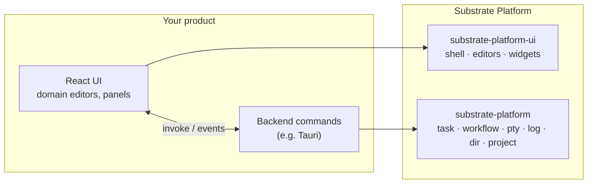

<div align="center">

<a id="top"></a>

# 🧱 Substrate Platform

### A brand-neutral core for building IDE-style desktop tools

[](LICENSE)
[](COMMERCIAL-LICENSE.md)
[](rust-toolchain.toml)
[](https://react.dev/)
[](https://codemirror.net/)

🇺🇸 **English** | 🇷🇺 [Русский](README.ru.md)

[Overview](#-overview) • [Rust Crate](#-rust-crate) • [UI Package](#-ui-package) • [Getting Started](#-getting-started) • [Development](#-development) • [License](#-license)

</div>

---

## 📖 Overview

**Substrate Platform** is the shared foundation for desktop tools that look
and work like an IDE. It knows nothing about any particular product: think of
how the IntelliJ Platform relates to IntelliJ IDEA, PyCharm or Rider. One
core, many products on top.

It comes in two halves:

| Half | Where | What it gives you |
|---|---|---|
| 🦀 **Rust crate** `substrate-platform` | repo root | Process and workflow runner, log sink, PTY terminals, file system helpers, project/solution model. No UI code. |
| ⚛️ **UI package** `substrate-platform-ui` | [`ui/`](ui) | Docking shell, editors, widgets, dialogs, settings, theme and i18n for React. Owns no backend. |

The product brings its own domain logic: its file formats, project
standards, workflow templates and commands. Substrate only provides the
parts every IDE needs anyway.

[Yog-IDLE](https://github.com/F000NKKK/Yog-IDLE) is the first product built
on it (a Tauri app using both halves).

<p align="center"></p>



## 🦀 Rust Crate

| Module | What it does |
|---|---|
| `task` | Runs an external process without blocking and streams stdout/stderr line by line into a `LogSink`. `TaskHandle` has `is_running`, `exit_status`, `wait` and `cancel` (which kills the whole process tree). |
| `workflow` | Named multi-step flows from a TOML file. Steps run in order and stop at the first failure; a step can call another workflow (cycles are detected); `${var}` is substituted. `WorkflowHandle` has `result`, `wait` and `cancel`. |
| `log` | A cloneable, append-only `LogSink`: read or drain it, or stream new lines with `on_push`. Retention is bounded (`set_max_lines`). |
| `pty` | A real cross-platform pseudo-terminal (`PtySession`, via `portable-pty`), with `PtyOptions` and `spawn_utf8` / `Utf8Chunker` so output never splits a multi-byte character. |
| `shell` | `detect_shells()` lists the shells that are actually installed. |
| `dir` | One-level directory listing (folders first, case-insensitive), create/rename/remove, read/write as text or bytes. |
| `project` | `ProjectStandard` detection by marker files, `Project`, and `Solution` (a TOML file with several projects, load/save). The host defines its own standards. |

Which paths a host may touch is deliberately left to the host, one layer up.

### Run a task

```rust
use substrate_platform::{LogSink, Task, spawn_task};

let sink = LogSink::new();
sink.on_push(|line| println!("{:?} {}", line.level, line.text));

let handle = spawn_task(Task::new("cargo").arg("build").cwd("/path/to/project"), sink)?;
let exit = handle.wait();
println!("success: {}, code: {:?}", exit.success, exit.code);
```

### Run a workflow

```toml
# workflow.toml
[workflow.build]
description = "Build in release mode"
steps = [{ run = "cargo", args = ["build", "--release"] }]

[workflow.ci]
steps = [
    { run = "cargo", args = ["fmt", "--check"] },
    { workflow = "build" },
    { run = "cargo", args = ["test"], env = { RUST_LOG = "${log}" } },
]
```

```rust
use std::collections::HashMap;
use substrate_platform::{LogSink, WorkflowFile, run_workflow};

let file = WorkflowFile::parse(&std::fs::read_to_string("workflow.toml")?)?;
let vars = HashMap::from([("log".to_string(), "debug".to_string())]);
let result = run_workflow(file, "ci", vars, ".", LogSink::new()).wait();
assert!(result.is_success());
```

## ⚛️ UI Package

Source only: `main` and `types` point at `src/index.tsx`, and the host's
bundler compiles it. Peer dependency: React 19.

### 🪟 Docking shell
`PlatformShell` with its own dock engine (no third-party docking library):
a tabbed center dock, left/right/bottom tool windows that auto-hide or pin,
drag and drop between edges and the center, floating panels, per-panel
sizes, and a menu bar and status bar slot. With `persistKey` the layout is
saved through the `StateStore` (`localStorage` by default, or the host's own
store, e.g. one file per project). `useShell()` lets any panel show, hide or
activate others.

```tsx
import { PlatformShell, ThemeProvider, StatusBar } from "substrate-platform-ui";

<ThemeProvider>
  <PlatformShell
    main={{ id: "editor", title: "Editor", component: EditorArea }}
    toolWindows={{
      left: [{ id: "files", title: "Files", component: FilesPanel }],
      bottom: [{ id: "output", title: "Output", component: OutputArea }],
    }}
    defaultPinned={{ left: "files" }}
    persistKey="my-app"
    statusBar={<StatusBar /* ... */ />}
  />
</ThemeProvider>
```

### ✍️ Editors
- `resolveEditor(filename)` picks an editor by extension: CodeMirror 6 text
  and code editors (breakpoint gutter, per-language highlighting), Markdown
  with preview (GFM, KaTeX, Mermaid), a `.properties` grid and an image viewer
- `DiffEditor` for side-by-side diffs

### 🧩 Widgets
| Group | Widgets |
|---|---|
| Chrome | `MenuBar`, `Toolbar`, `RunBar`, `StatusBar`, `Tab`, `WindowControls`, `FloatingWindow`, `SplitPane` |
| Data | `Tree`, `FileTree` + `useDirectoryTree`, `DataGrid`, `PropertyGrid`, `ComponentList`, form fields (`FormPage`, `CommitTextField`, `SelectField`...) |
| Output | `OutputPanel`, `TerminalPanel` (xterm.js on a real PTY), `SearchResults`, `HighlightedText`, `SymbolIcon` |
| Interaction | `Dialog` (`showDialog`, `confirmDialog`, `promptDialog`), `notify`, `QuickPick`, `SearchField`, `ContextMenu` |
| Design | `DesignSurface` (selection, move/resize adorners), `ColorWheel`, `Swatch`, color fields |
| Basics | `Button`, `IconButton`, `Label`, `TextField` |

### 🎨 Infrastructure
- Design tokens as `--sp-*` CSS variables, `ThemeProvider` with accent color
  and editor color schemes, an icon registry, color utilities
- `StateStore` for UI state that survives restarts, selection and keyboard
  shortcut helpers, drag-and-drop helpers, an outline model
- i18n with English and Russian built in
- `SettingsWindow` and `ColorPickerWindow`, with ready Appearance, Editor and
  International settings pages

Backend calls are passed in as callbacks or as configurable Tauri command
and event names with defaults, so the package never assumes a backend of
its own.

## 🚀 Getting Started

The crate and the UI package aren't published yet; use path dependencies:

```toml
# Cargo.toml
[dependencies]
substrate-platform = { path = "../Substrate-Platform" }
```

```jsonc
// package.json
"dependencies": {
  "substrate-platform-ui": "file:../Substrate-Platform/ui"
}
```

Run `npm install` in `Substrate-Platform/ui` once so its own dependencies
(CodeMirror, xterm.js...) are in place.

## 🛠️ Development

```sh
cargo build
cargo test
cargo clippy --all-targets
```

The toolchain is pinned to Rust 1.99 in `rust-toolchain.toml`.

Contribution rule: everything here must stay generic. A feature that only
makes sense for one product belongs in that product.

## 📄 License

Dual-licensed: **AGPL-3.0-only** ([LICENSE](LICENSE)), free for any use that
complies with the AGPL, or a **Commercial License** for closed-source use,
free below $1,000/month net profit with a sliding royalty above that. See
[COMMERCIAL-LICENSE.md](COMMERCIAL-LICENSE.md).

---

<div align="center">

**[⬆ Back to Top](#top)**

</div>
