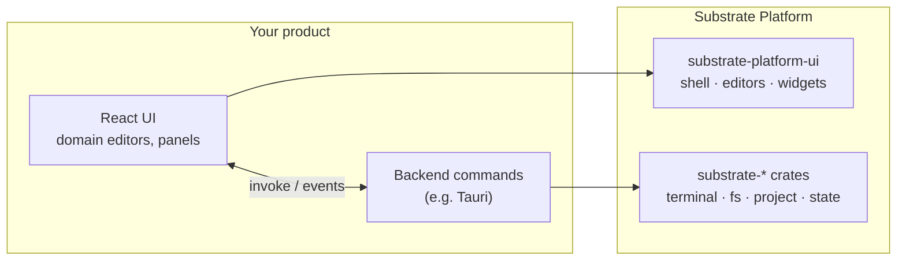

<div align="center">

<a id="top"></a>

# 🧱 Substrate Platform

### A brand-neutral core for building IDE-style desktop tools

[](LICENSE)
[](COMMERCIAL-LICENSE.md)
[](rust-toolchain.toml)
[](https://react.dev/)
[](https://codemirror.net/)

🇺🇸 **English** | 🇷🇺 [Русский](README.ru.md)

[Overview](#-overview) • [Rust Crate](#-rust-crate) • [UI Package](#-ui-package) • [Getting Started](#-getting-started) • [Development](#-development) • [License](#-license)

</div>

---

## 📖 Overview

**Substrate Platform** is the shared foundation for desktop tools that look
and work like an IDE. It knows nothing about any particular product: think of
how the IntelliJ Platform relates to IntelliJ IDEA, PyCharm or Rider. One
core, many products on top.

It comes in two halves:

| Half | Where | What it gives you |
|---|---|---|
| 🦀 **Rust crates** `substrate-*` | [`crates/`](crates) | Process and workflow runner, log sink, PTY terminals, file system helpers, project/solution model, language servers, debug adapters, Source Control, search. No UI code. |
| ⚛️ **UI package** `substrate-platform-ui` | [`ui/`](ui) | Docking shell, editors, widgets, dialogs, settings, theme and i18n for React. Owns no backend. |

The product brings its own domain logic: its file formats, project
standards, workflow templates and commands. Substrate only provides the
parts every IDE needs anyway.

[Yog-IDLE](https://github.com/F000NKKK/Yog-IDLE) is the first product built
on it (a Tauri app using both halves).

<p align="center"></p>



## 🦀 Rust Crate

The Rust side is a set of crates under [`crates/`](crates), one group per context and layer (domain, app, adapter; the layers and edges are in [`craftbook.toml`](craftbook.toml), the vocabulary in [`docs/context-map.md`](docs/context-map.md)). There is no facade crate: a product depends on the crates it uses, and the Tauri plugin `tauri-plugin-substrate` ([`tauri-plugin/`](tauri-plugin)) wires them to commands behind Cargo features (`dap`, `fs`, `git`, `lsp`, `search`, `state`, `terminal`). `lsp`'s languages and `dap`'s adapters are the product's, passed in `Options::languages` and `Options::adapters`.

| Context | Crates | What it does |
|---|---|---|
| shared kernel | [`substrate-message`](crates/substrate-message), [`substrate-lock`](crates/substrate-lock), [`substrate-framing`](crates/substrate-framing) | `Message` (user-facing text as templates the UI translates) and the `messages!` macro; `Locked`/`ReadWrite` (locks that outlive a panic); Content-Length framing. |
| workspace | `substrate-workspace-domain`, `-app`, `-fs` | The folders the user opened (paths outside them are refused), listing, changing and watching them, and a product's binary formats read as text (`TextViews`). `PathResolver` is the port. |
| run | `substrate-run-domain`, `-app`, `-process`, `-toml` | Tasks streamed line by line into a `LogSink`, workflows of them (steps in order, nested workflows, `${var}`), `ProcessLauncher` and `ServiceLauncher` ports, `SystemLauncher` (kills whole process trees; the only `unsafe`). |
| process | [`substrate-process`](crates/substrate-process) | Starting programs with the system's own environment, opening links and files. |
| terminal | `substrate-terminal-domain`, `-app`, `-pty` | A real pseudo-terminal behind the `PtyOpener` port, `Utf8Chunker`, the installed shells. |
| language-server | `substrate-lsp-domain`, `-app`, `-toml` | The product's languages and their servers over the Language Server Protocol (`Client`, started through `ServiceLauncher`). |
| debug-adapter | `substrate-dap-domain`, `-app`, `-toml` | The product's debug adapters over the Debug Adapter Protocol. |
| project-model | `substrate-project-domain`, `-app`, `-toml` | `Solution` and `Project`, no format of its own: the product implements `SolutionFormat`/`ProjectFormat` and registers them in `Formats`; `ProjectStandard` tells a project's kind. |
| ide-state | [`substrate-state-json`](crates/substrate-state-json) | A project's and the app's JSON state: reading never fails, writing is atomic. |
| source-control | `substrate-git-domain`, `-app`, `-gitcli` | Status, staging, commits, branches, remotes, stashes and diffs through the `git` executable. |
| search | `substrate-search-domain`, `-app`, `-ignore` | Find and Replace in Files over a `.gitignore`-aware walk. |
| host-ui-contract | [`substrate-host-contract`](crates/substrate-host-contract), [`tauri-plugin/`](tauri-plugin) | The command and event catalog the UI is generated from (`cargo run -p substrate-host-contract --all-features --bin substrate-messages`) and the Tauri plugin. |

Moving from the former `substrate-platform` crate: [docs/migration-waves-9-11.md](docs/migration-waves-9-11.md).

The UI's `ui/src/inspector` is a product-neutral data inspector: `DataInspector` shows a value (Substrate Data's JSON form) and the `ShapeDoc` that describes it (`{ root, defs }`, as `substrate_data::json` writes it) as a property tree — structs, lists, maps, optionals, plain and tagged enums, scalars with their types. Props: `shape` (the `ShapeDoc` JSON, parsed with typed `InspectorError`s, or a `ShapeDescription`), `value`, `readOnly` (default `true`), `onEdit(path, value)` (only called when editable: bool, integer, float, string and enum variant, validated against the shape), `diagnostics` (`{ path, message }`, shown on rows and their ancestors) and `rootName`. The pure model (`parseShapeDescription`, `buildRows`) is exported too; the host decides what an edit does.

Which paths a host may touch is deliberately left to the host, one layer up.

### Run a task

```rust
use substrate_run_app::{LogSink, spawn};
use substrate_run_domain::Task;
use substrate_run_process::SystemLauncher;

let sink = LogSink::new();
sink.on_push(|line| println!("{:?} {}", line.level, line.text));

let task = Task::new("cargo").arg("build").cwd("/path/to/project");
let handle = spawn(&SystemLauncher, &task, sink)?;
let exit = handle.wait();
println!("success: {}, code: {:?}", exit.success, exit.code);
```

### Run a workflow

```toml
# workflow.toml
[workflow.build]
description = "Build in release mode"
steps = [{ run = "cargo", args = ["build", "--release"] }]

[workflow.ci]
steps = [
    { run = "cargo", args = ["fmt", "--check"] },
    { workflow = "build" },
    { run = "cargo", args = ["test"], env = { RUST_LOG = "${log}" } },
]
```

```rust
use std::collections::HashMap;
use std::sync::Arc;
use substrate_run_app::LogSink;
use substrate_run_app::workflow::{Request, run};
use substrate_run_process::SystemLauncher;
use substrate_run_toml::parse_workflow;

let file = parse_workflow(&std::fs::read_to_string("workflow.toml")?)?;
let vars = HashMap::from([("log".to_string(), "debug".to_string())]);
let request = Request { file, name: "ci".to_string(), vars, cwd: ".".into() };
let result = run(Arc::new(SystemLauncher), request, LogSink::new()).wait();
assert!(result.is_success());
```

## ⚛️ UI Package

Source only: `main` and `types` point at `src/index.tsx`, and the host's
bundler compiles it. Peer dependency: React 19.

### 🪟 Docking shell
`PlatformShell` with its own dock engine (no third-party docking library):
a tabbed center dock, left/right/bottom tool windows that auto-hide or pin,
drag and drop between edges and the center, floating panels, per-panel
sizes, and a menu bar and status bar slot. With `persistKey` the layout is
saved through the `StateStore` (`localStorage` by default, or the host's own
store, e.g. one file per project). `useShell()` lets any panel show, hide or
activate others.

```tsx
import { PlatformShell, ThemeProvider, StatusBar } from "substrate-platform-ui";

<ThemeProvider>
  <PlatformShell
    main={{ id: "editor", title: "Editor", component: EditorArea }}
    toolWindows={{
      left: [{ id: "files", title: "Files", component: FilesPanel }],
      bottom: [{ id: "output", title: "Output", component: OutputArea }],
    }}
    defaultPinned={{ left: "files" }}
    persistKey="my-app"
    statusBar={<StatusBar /* ... */ />}
  />
</ThemeProvider>
```

### ✍️ Editors
- `resolveEditor(filename)` picks an editor by extension: CodeMirror 6 text
  and code editors (breakpoint gutter, per-language highlighting), Markdown
  with preview (GFM, KaTeX, Mermaid), a `.properties` grid and an image viewer
- `DiffEditor` for side-by-side diffs
- Source Control windows (`GitHost`) and Find and Replace in Files (`FindHost`,
  `FindInFilesWindow`, `FindResultsPanel`) over the plugin's `git` and `search`
- `WorkspaceProvider`: the open folders, and what happens when the window closes

### 🧩 Widgets
| Group | Widgets |
|---|---|
| Chrome | `MenuBar`, `Toolbar`, `RunBar`, `StatusBar`, `Tab`, `WindowControls`, `FloatingWindow`, `SplitPane` |
| Data | `Tree`, `FileTree` + `useDirectoryTree`, `DataGrid`, `PropertyGrid`, `ComponentList`, form fields (`FormPage`, `CommitTextField`, `SelectField`...) |
| Output | `OutputPanel`, `TerminalPanel` (xterm.js on a real PTY), `SearchResults`, `HighlightedText`, `SymbolIcon` |
| Interaction | `Dialog` (`showDialog`, `confirmDialog`, `promptDialog`), `notify`, `QuickPick`, `SearchField`, `ContextMenu` |
| Design | `DesignSurface` (selection, move/resize adorners), `ColorWheel`, `Swatch`, color fields |
| Basics | `Button`, `IconButton`, `Label`, `TextField` |

### 🎨 Infrastructure
- Design tokens as `--sp-*` CSS variables, `ThemeProvider` with accent color
  and editor color schemes, an icon registry, color utilities
- `StateStore` for UI state that survives restarts, selection and keyboard
  shortcut helpers, drag-and-drop helpers, an outline model
- Diagnostics (problems placed in a document), file types, undo history
- i18n with English and Russian built in
- `SettingsWindow` and `ColorPickerWindow`, with ready Appearance, Editor and
  International settings pages

Backend calls are passed in as callbacks or as configurable Tauri command
and event names with defaults, so the package never assumes a backend of
its own.

## 🚀 Getting Started

The crate and the UI package aren't published yet; use path dependencies:

```toml
# Cargo.toml
[dependencies]
# the crates you use, e.g.
substrate-run-app = { path = "../Substrate-Platform/crates/substrate-run-app" }
substrate-workspace-fs = { path = "../Substrate-Platform/crates/substrate-workspace-fs" }
```

```jsonc
// package.json
"dependencies": {
  "substrate-platform-ui": "file:../Substrate-Platform/ui"
}
```

Run `npm install` in `Substrate-Platform/ui` once so its own dependencies
(CodeMirror, xterm.js...) are in place.

## 🛠️ Development

```sh
cargo build --workspace --all-features
cargo test --workspace --all-features
cargo clippy --workspace --all-targets --all-features
```

The toolchain is pinned to Rust 1.99 in `rust-toolchain.toml`.

Contribution rule: everything here must stay generic. A feature that only
makes sense for one product belongs in that product.

## 📄 License

Dual-licensed: **AGPL-3.0-only** ([LICENSE](LICENSE)), free for any use that
complies with the AGPL, or a **Commercial License** for closed-source use,
free below $1,000/month net profit with a sliding royalty above that. See
[COMMERCIAL-LICENSE.md](COMMERCIAL-LICENSE.md).

---

<div align="center">

**[⬆ Back to Top](#top)**

</div>
