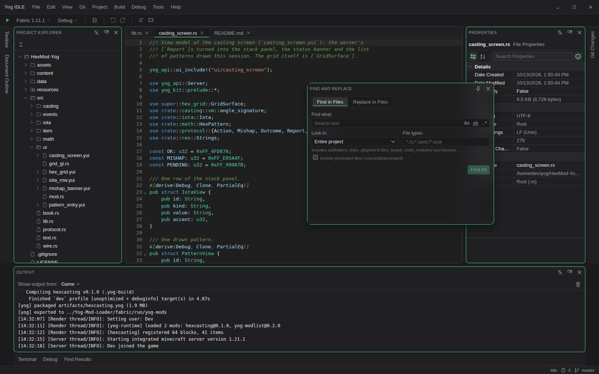
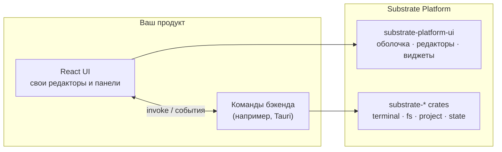

<div align="center">

<a id="top"></a>

# 🧱 Substrate Platform

### Нейтральное ядро для настольных инструментов в стиле IDE

[](LICENSE)
[](COMMERCIAL-LICENSE.md)
[](rust-toolchain.toml)
[](https://react.dev/)
[](https://codemirror.net/)

🇺🇸 [English](README.md) | 🇷🇺 **Русский**

[Обзор](#-обзор) • [Rust-крейт](#-rust-крейт) • [UI-пакет](#-ui-пакет) • [Подключение](#-подключение) • [Разработка](#-разработка) • [Лицензия](#-лицензия)

</div>

---

## 📖 Обзор

**Substrate Platform** — общая основа для настольных программ, которые
выглядят и работают как IDE. Она ничего не знает о конкретном продукте:
примерно как IntelliJ Platform относится к IntelliJ IDEA, PyCharm или Rider.
Одно ядро, много продуктов поверх него.

Состоит из двух половин:

| Часть | Где | Что даёт |
|---|---|---|
| 🦀 **Rust-крейты** `substrate-*` | [`crates/`](crates) | Запуск процессов и workflow, журнал вывода, PTY-терминалы, работа с файлами, модель проектов и решений, языковые серверы, адаптеры отладки, система управления версиями, поиск. Без UI. |
| ⚛️ **UI-пакет** `substrate-platform-ui` | [`ui/`](ui) | Оконная оболочка с докингом, редакторы, виджеты, диалоги, настройки, темы и локализация для React. Своего бэкенда не имеет. |

Предметную логику продукт приносит сам: свои форматы файлов, типы проектов,
шаблоны workflow и команды. Substrate даёт только то, что нужно любой IDE.

Первый продукт на этой платформе —
[Yog-IDLE](https://github.com/F000NKKK/Yog-IDLE) (приложение на Tauri,
использует обе половины).

<p align="center"></p>



## 🦀 Rust-крейт

Rust-часть — набор крейтов в [`crates/`](crates), по группе на контекст и слой (domain, app, адаптер; слои и связи в [`craftbook.toml`](craftbook.toml), словарь в [`docs/context-map.md`](docs/context-map.md)). Крейта-фасада нет: продукт зависит от нужных ему крейтов, а Tauri-плагин `tauri-plugin-substrate` ([`tauri-plugin/`](tauri-plugin)) связывает их с командами за Cargo-features (`dap`, `fs`, `git`, `lsp`, `search`, `state`, `terminal`). Языки `lsp` и адаптеры `dap` задаёт продукт через `Options::languages` и `Options::adapters`.

| Контекст | Крейты | Что делает |
|---|---|---|
| общее ядро | [`substrate-message`](crates/substrate-message), [`substrate-lock`](crates/substrate-lock), [`substrate-framing`](crates/substrate-framing) | `Message` (текст для пользователя как шаблоны, которые переводит UI) и макрос `messages!`; `Locked`/`ReadWrite` (блокировки, переживающие панику); кадрирование Content-Length. |
| workspace | `substrate-workspace-domain`, `-app`, `-fs` | Открытые пользователем папки (пути вне их отклоняются), их просмотр, изменение и наблюдение, бинарные форматы продукта как текст (`TextViews`). Порт — `PathResolver`. |
| run | `substrate-run-domain`, `-app`, `-process`, `-toml` | Задачи с построчным выводом в `LogSink`, workflow из них (шаги по порядку, вложенные workflow, `${var}`), порты `ProcessLauncher` и `ServiceLauncher`, `SystemLauncher` (убивает деревья процессов; единственный `unsafe`). |
| process | [`substrate-process`](crates/substrate-process) | Запуск программ с окружением системы, открытие ссылок и файлов. |
| terminal | `substrate-terminal-domain`, `-app`, `-pty` | Настоящий псевдотерминал за портом `PtyOpener`, `Utf8Chunker`, установленные оболочки. |
| language-server | `substrate-lsp-domain`, `-app`, `-toml` | Языки продукта и их серверы по Language Server Protocol (`Client`, запуск через `ServiceLauncher`). |
| debug-adapter | `substrate-dap-domain`, `-app`, `-toml` | Адаптеры отладки продукта по Debug Adapter Protocol. |
| project-model | `substrate-project-domain`, `-app`, `-toml` | `Solution` и `Project` без собственного формата: продукт реализует `SolutionFormat`/`ProjectFormat` и регистрирует их в `Formats`; `ProjectStandard` определяет вид проекта. |
| ide-state | [`substrate-state-json`](crates/substrate-state-json) | JSON-состояние проекта и приложения: чтение не падает, запись атомарна. |
| source-control | `substrate-git-domain`, `-app`, `-gitcli` | Состояние, индекс, фиксации, ветви, remotes, stash и сравнения через `git`. |
| search | `substrate-search-domain`, `-app`, `-ignore` | Поиск и замена в файлах с обходом, учитывающим `.gitignore`. |
| host-ui-contract | [`substrate-host-contract`](crates/substrate-host-contract), [`tauri-plugin/`](tauri-plugin) | Каталог команд и событий, из которого генерируется UI (`cargo run -p substrate-host-contract --all-features --bin substrate-messages`), и Tauri-плагин. |

Переход со старого крейта `substrate-platform`: [docs/migration-waves-9-11.md](docs/migration-waves-9-11.md).

Какие пути хосту можно трогать, решает сам хост, уровнем выше.

### Запуск задачи

```rust
use substrate_run_app::{LogSink, spawn};
use substrate_run_domain::Task;
use substrate_run_process::SystemLauncher;

let sink = LogSink::new();
sink.on_push(|line| println!("{:?} {}", line.level, line.text));

let task = Task::new("cargo").arg("build").cwd("/path/to/project");
let handle = spawn(&SystemLauncher, &task, sink)?;
let exit = handle.wait();
println!("success: {}, code: {:?}", exit.success, exit.code);
```

### Запуск workflow

```toml
# workflow.toml
[workflow.build]
description = "Release-сборка"
steps = [{ run = "cargo", args = ["build", "--release"] }]

[workflow.ci]
steps = [
    { run = "cargo", args = ["fmt", "--check"] },
    { workflow = "build" },
    { run = "cargo", args = ["test"], env = { RUST_LOG = "${log}" } },
]
```

```rust
use std::collections::HashMap;
use std::sync::Arc;
use substrate_run_app::LogSink;
use substrate_run_app::workflow::{Request, run};
use substrate_run_process::SystemLauncher;
use substrate_run_toml::parse_workflow;

let file = parse_workflow(&std::fs::read_to_string("workflow.toml")?)?;
let vars = HashMap::from([("log".to_string(), "debug".to_string())]);
let request = Request { file, name: "ci".to_string(), vars, cwd: ".".into() };
let result = run(Arc::new(SystemLauncher), request, LogSink::new()).wait();
assert!(result.is_success());
```

## ⚛️ UI-пакет

Поставляется исходниками: `main` и `types` указывают на `src/index.tsx`, а
компилирует его сборщик хоста. Peer-зависимость: React 19.

### 🪟 Оболочка с докингом
`PlatformShell` со своим движком докинга (без сторонних библиотек):
центральная зона с вкладками, панели слева, справа и снизу, которые
автоматически скрываются или закрепляются, перетаскивание между краями и
центром, плавающие панели, размеры для каждой панели, места под меню и
строку состояния. С `persistKey` раскладка сохраняется через `StateStore`
(по умолчанию `localStorage`, либо хранилище хоста, например файл на каждый
проект). Через `useShell()` любая панель может показать, скрыть или
активировать другие.

```tsx
import { PlatformShell, ThemeProvider, StatusBar } from "substrate-platform-ui";

<ThemeProvider>
  <PlatformShell
    main={{ id: "editor", title: "Editor", component: EditorArea }}
    toolWindows={{
      left: [{ id: "files", title: "Files", component: FilesPanel }],
      bottom: [{ id: "output", title: "Output", component: OutputArea }],
    }}
    defaultPinned={{ left: "files" }}
    persistKey="my-app"
    statusBar={<StatusBar /* ... */ />}
  />
</ThemeProvider>
```

### ✍️ Редакторы
- `resolveEditor(filename)` выбирает редактор по расширению: текстовый и
  кодовый на CodeMirror 6 (поле для точек останова, подсветка языков),
  Markdown с предпросмотром (GFM, KaTeX, Mermaid), таблица для
  `.properties` и просмотр изображений
- `DiffEditor` для сравнения двух версий
- Окна системы управления версиями (`GitHost`) и поиска с заменой в файлах
  (`FindHost`, `FindInFilesWindow`, `FindResultsPanel`) поверх `git` и `search` плагина
- `WorkspaceProvider`: открытые папки и то, что происходит при закрытии окна

### 🧩 Виджеты
| Группа | Виджеты |
|---|---|
| Каркас | `MenuBar`, `Toolbar`, `RunBar`, `StatusBar`, `Tab`, `WindowControls`, `FloatingWindow`, `SplitPane` |
| Данные | `Tree`, `FileTree` + `useDirectoryTree`, `DataGrid`, `PropertyGrid`, `ComponentList`, поля форм (`FormPage`, `CommitTextField`, `SelectField`...) |
| Вывод | `OutputPanel`, `TerminalPanel` (xterm.js на настоящем PTY), `SearchResults`, `HighlightedText`, `SymbolIcon` |
| Взаимодействие | `Dialog` (`showDialog`, `confirmDialog`, `promptDialog`), `notify`, `QuickPick`, `SearchField`, `ContextMenu` |
| Дизайн | `DesignSurface` (выделение, маркеры перемещения и изменения размера), `ColorWheel`, `Swatch`, поля выбора цвета |
| Основа | `Button`, `IconButton`, `Label`, `TextField` |

### 🎨 Инфраструктура
- Дизайн-токены в CSS-переменных `--sp-*`, `ThemeProvider` с акцентным
  цветом и схемами редактора, реестр иконок, работа с цветом
- `StateStore` для состояния UI между запусками, выделение, горячие клавиши,
  помощники для drag-and-drop, модель структуры документа (outline)
- Диагностика (проблемы, привязанные к месту в документе), типы файлов,
  история отмены
- Локализация: английский и русский из коробки
- `SettingsWindow` и `ColorPickerWindow` с готовыми страницами настроек
  «Внешний вид», «Редактор» и «Язык и регион»

Вызовы бэкенда передаются колбэками или настраиваемыми именами Tauri-команд
и событий (с разумными значениями по умолчанию), поэтому пакет не
навязывает свой бэкенд.

## 🚀 Подключение

Крейт и UI-пакет пока не опубликованы, подключайте их по пути:

```toml
# Cargo.toml
[dependencies]
# the crates you use, e.g.
substrate-run-app = { path = "../Substrate-Platform/crates/substrate-run-app" }
substrate-workspace-fs = { path = "../Substrate-Platform/crates/substrate-workspace-fs" }
```

```jsonc
// package.json
"dependencies": {
  "substrate-platform-ui": "file:../Substrate-Platform/ui"
}
```

Один раз выполните `npm install` в `Substrate-Platform/ui`, чтобы
подтянулись его зависимости (CodeMirror, xterm.js и другие).

## 🛠️ Разработка

```sh
cargo build --workspace --all-features
cargo test --workspace --all-features
cargo clippy --workspace --all-targets --all-features
```

Версия Rust (1.99) закреплена в `rust-toolchain.toml`.

Главное правило: всё здесь остаётся универсальным. Возможность, которая
нужна только одному продукту, живёт в этом продукте.

## 📄 Лицензия

Двойная лицензия: **AGPL-3.0-only** ([LICENSE](LICENSE)) — бесплатно для
любого использования в рамках AGPL, или **коммерческая лицензия** для
закрытого кода: бесплатно при чистой прибыли до $1 000 в месяц, выше —
плавающие отчисления. Подробности в
[COMMERCIAL-LICENSE.md](COMMERCIAL-LICENSE.md).

---

<div align="center">

**[⬆ Наверх](#top)**

</div>
