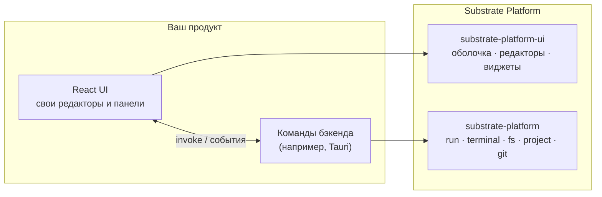

<div align="center">

<a id="top"></a>

# 🧱 Substrate Platform

### Нейтральное ядро для настольных инструментов в стиле IDE

[](LICENSE)
[](COMMERCIAL-LICENSE.md)
[](rust-toolchain.toml)
[](https://react.dev/)
[](https://codemirror.net/)

🇺🇸 [English](README.md) | 🇷🇺 **Русский**

[Обзор](#-обзор) • [Rust-крейт](#-rust-крейт) • [UI-пакет](#-ui-пакет) • [Подключение](#-подключение) • [Разработка](#-разработка) • [Лицензия](#-лицензия)

</div>

---

## 📖 Обзор

**Substrate Platform** — общая основа для настольных программ, которые
выглядят и работают как IDE. Она ничего не знает о конкретном продукте:
примерно как IntelliJ Platform относится к IntelliJ IDEA, PyCharm или Rider.
Одно ядро, много продуктов поверх него.

Состоит из двух половин:

| Часть | Где | Что даёт |
|---|---|---|
| 🦀 **Rust-крейт** `substrate-platform` | корень репозитория | Запуск процессов и workflow, журнал вывода, PTY-терминалы, работа с файлами, модель проектов и решений. Без UI. |
| ⚛️ **UI-пакет** `substrate-platform-ui` | [`ui/`](ui) | Оконная оболочка с докингом, редакторы, виджеты, диалоги, настройки, темы и локализация для React. Своего бэкенда не имеет. |

Предметную логику продукт приносит сам: свои форматы файлов, типы проектов,
шаблоны workflow и команды. Substrate даёт только то, что нужно любой IDE.

Первый продукт на этой платформе —
[Yog-IDLE](https://github.com/F000NKKK/Yog-IDLE) (приложение на Tauri,
использует обе половины).

<p align="center"></p>



## 🦀 Rust-крейт

Всегда есть: `message` (тексты для пользователя в виде шаблонов, которые переводит UI), `events`, `process` (каким должно быть окружение запущенной программы) `workspace` (открытые пользователем папки; пути вне их отклоняются), `sync` (блокировки, переживающие панику), `text_view` (бинарные форматы продукта читаются и пишутся как текст, чтобы поиск, замена и сравнения видели то же, что редактор) и `commands` (команды хоста по доменам: единый список, из которого получаются разрешения, обработчики и копия для UI). Остальные модули — Cargo features с тем же именем, продукт собирает только то, чем пользуется (`full` включает все):

| Feature / модуль | Что делает |
|---|---|
| `run` | `run::task` запускает внешний процесс без блокировки и построчно передаёт stdout/stderr в `LogSink`; у `TaskHandle` есть `is_running`, `exit_status`, `wait` и `cancel` (завершает всё дерево процессов). `run::workflow`: именованные многошаговые сценарии из TOML — шаги идут по порядку и останавливаются на первой ошибке, шаг может вызвать другой сценарий (циклы обнаруживаются), подставляется `${var}`. `run::log`: клонируемый журнал `LogSink` только на добавление, с ограниченным хранением. |
| `terminal` | Настоящий кроссплатформенный псевдотерминал (`PtySession`, через `portable-pty`) с `PtyOptions`; `Utf8Chunker`, чтобы вывод не разрывал многобайтовые символы; `detect_shells()` перечисляет установленные оболочки. |
| `fs` | `fs::dir`: список содержимого папки (сначала папки, без учёта регистра), создание/переименование/удаление, чтение/запись текста или байтов. `fs::watch`: `DirectoryWatcher`, уведомления об изменениях с подавлением дребезга. |
| `project` | Модель проектов и решений и API к ней — без собственного формата и без чтения файлов. `Solution`: папки решения, конфигурации и платформы, конфигурация каждого проекта для каждой конфигурации решения, зависимости сборки (`build_order`), а также упорядоченные свойства и секции для всего остального, что хранит формат; `Project`: свойства (в том числе по конфигурациям), целевые платформы, элементы, ссылки. Продукт реализует `SolutionFormat` / `ProjectFormat` для своих файлов (`.sln`, `.slnx`, `.csproj`, свои) и регистрирует их в `Formats`; `ProjectStandard` определяет вид проекта по списку файлов, который передаёт продукт. |
| `search` | Поиск и замена в файлах: обход проекта с учётом `.gitignore` (или только несохранённых буферов открытых документов), результаты по файлам; что обход пропускает, задаёт `Layout` продукта. |
| `state` | Что IDE помнит между запусками: JSON-состояние проекта и приложения; чтение никогда не падает, запись атомарна. |
| `git` | Система управления версиями через CLI `git`: состояние, индексирование, фиксации, сравнения, история, ветви, удалённые репозитории, спрятанные изменения, параметры. |

У Tauri-плагина `tauri-plugin-substrate` ([`tauri-plugin/`](tauri-plugin)) те же features для его команд (`fs`, `git`, `search`, `state`, `terminal`).

Какие пути хосту можно трогать, решает сам хост, уровнем выше.

### Запуск задачи

```rust
use substrate_platform::run::{LogSink, Task, spawn_task};

let sink = LogSink::new();
sink.on_push(|line| println!("{:?} {}", line.level, line.text));

let handle = spawn_task(Task::new("cargo").arg("build").cwd("/path/to/project"), sink)?;
let exit = handle.wait();
println!("success: {}, code: {:?}", exit.success, exit.code);
```

### Запуск workflow

```toml
# workflow.toml
[workflow.build]
description = "Release-сборка"
steps = [{ run = "cargo", args = ["build", "--release"] }]

[workflow.ci]
steps = [
    { run = "cargo", args = ["fmt", "--check"] },
    { workflow = "build" },
    { run = "cargo", args = ["test"], env = { RUST_LOG = "${log}" } },
]
```

```rust
use std::collections::HashMap;
use substrate_platform::run::{LogSink, workflow};

let file = workflow::File::parse(&std::fs::read_to_string("workflow.toml")?)?;
let vars = HashMap::from([("log".to_string(), "debug".to_string())]);
let result = workflow::run(file, "ci", vars, ".", LogSink::new()).wait();
assert!(result.is_success());
```

## ⚛️ UI-пакет

Поставляется исходниками: `main` и `types` указывают на `src/index.tsx`, а
компилирует его сборщик хоста. Peer-зависимость: React 19.

### 🪟 Оболочка с докингом
`PlatformShell` со своим движком докинга (без сторонних библиотек):
центральная зона с вкладками, панели слева, справа и снизу, которые
автоматически скрываются или закрепляются, перетаскивание между краями и
центром, плавающие панели, размеры для каждой панели, места под меню и
строку состояния. С `persistKey` раскладка сохраняется через `StateStore`
(по умолчанию `localStorage`, либо хранилище хоста, например файл на каждый
проект). Через `useShell()` любая панель может показать, скрыть или
активировать другие.

```tsx
import { PlatformShell, ThemeProvider, StatusBar } from "substrate-platform-ui";

<ThemeProvider>
  <PlatformShell
    main={{ id: "editor", title: "Editor", component: EditorArea }}
    toolWindows={{
      left: [{ id: "files", title: "Files", component: FilesPanel }],
      bottom: [{ id: "output", title: "Output", component: OutputArea }],
    }}
    defaultPinned={{ left: "files" }}
    persistKey="my-app"
    statusBar={<StatusBar /* ... */ />}
  />
</ThemeProvider>
```

### ✍️ Редакторы
- `resolveEditor(filename)` выбирает редактор по расширению: текстовый и
  кодовый на CodeMirror 6 (поле для точек останова, подсветка языков),
  Markdown с предпросмотром (GFM, KaTeX, Mermaid), таблица для
  `.properties` и просмотр изображений
- `DiffEditor` для сравнения двух версий
- Окна системы управления версиями (`GitHost`) и поиска с заменой в файлах
  (`FindHost`, `FindInFilesWindow`, `FindResultsPanel`) поверх `git` и `search` крейта
- `WorkspaceProvider`: открытые папки и то, что происходит при закрытии окна

### 🧩 Виджеты
| Группа | Виджеты |
|---|---|
| Каркас | `MenuBar`, `Toolbar`, `RunBar`, `StatusBar`, `Tab`, `WindowControls`, `FloatingWindow`, `SplitPane` |
| Данные | `Tree`, `FileTree` + `useDirectoryTree`, `DataGrid`, `PropertyGrid`, `ComponentList`, поля форм (`FormPage`, `CommitTextField`, `SelectField`...) |
| Вывод | `OutputPanel`, `TerminalPanel` (xterm.js на настоящем PTY), `SearchResults`, `HighlightedText`, `SymbolIcon` |
| Взаимодействие | `Dialog` (`showDialog`, `confirmDialog`, `promptDialog`), `notify`, `QuickPick`, `SearchField`, `ContextMenu` |
| Дизайн | `DesignSurface` (выделение, маркеры перемещения и изменения размера), `ColorWheel`, `Swatch`, поля выбора цвета |
| Основа | `Button`, `IconButton`, `Label`, `TextField` |

### 🎨 Инфраструктура
- Дизайн-токены в CSS-переменных `--sp-*`, `ThemeProvider` с акцентным
  цветом и схемами редактора, реестр иконок, работа с цветом
- `StateStore` для состояния UI между запусками, выделение, горячие клавиши,
  помощники для drag-and-drop, модель структуры документа (outline)
- Диагностика (проблемы, привязанные к месту в документе), типы файлов,
  история отмены
- Локализация: английский и русский из коробки
- `SettingsWindow` и `ColorPickerWindow` с готовыми страницами настроек
  «Внешний вид», «Редактор» и «Язык и регион»

Вызовы бэкенда передаются колбэками или настраиваемыми именами Tauri-команд
и событий (с разумными значениями по умолчанию), поэтому пакет не
навязывает свой бэкенд.

## 🚀 Подключение

Крейт и UI-пакет пока не опубликованы, подключайте их по пути:

```toml
# Cargo.toml
[dependencies]
substrate-platform = { path = "../Substrate-Platform" }
```

```jsonc
// package.json
"dependencies": {
  "substrate-platform-ui": "file:../Substrate-Platform/ui"
}
```

Один раз выполните `npm install` в `Substrate-Platform/ui`, чтобы
подтянулись его зависимости (CodeMirror, xterm.js и другие).

## 🛠️ Разработка

```sh
cargo build
cargo test
cargo clippy --all-targets
```

Версия Rust (1.99) закреплена в `rust-toolchain.toml`.

Главное правило: всё здесь остаётся универсальным. Возможность, которая
нужна только одному продукту, живёт в этом продукте.

## 📄 Лицензия

Двойная лицензия: **AGPL-3.0-only** ([LICENSE](LICENSE)) — бесплатно для
любого использования в рамках AGPL, или **коммерческая лицензия** для
закрытого кода: бесплатно при чистой прибыли до $1 000 в месяц, выше —
плавающие отчисления. Подробности в
[COMMERCIAL-LICENSE.md](COMMERCIAL-LICENSE.md).

---

<div align="center">

**[⬆ Наверх](#top)**

</div>
